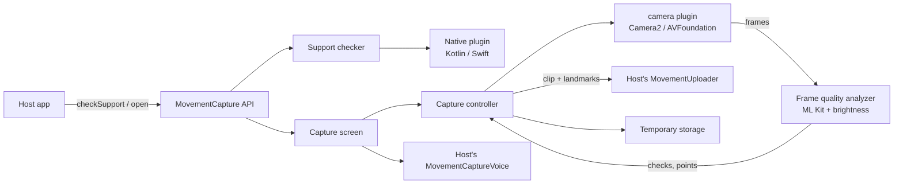
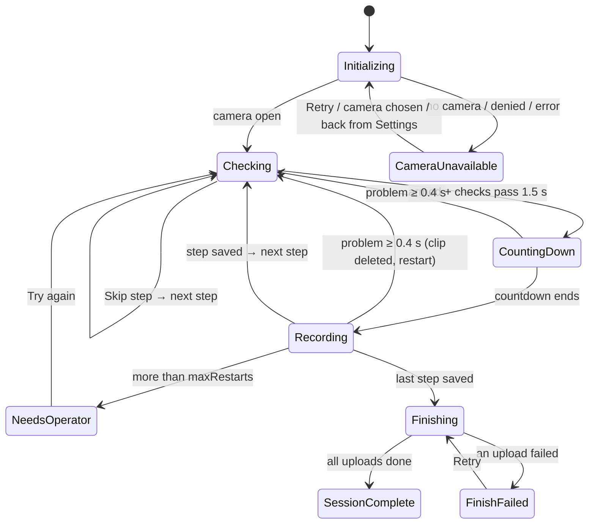

# Architecture

This document explains how `movement_capture` works inside. For using it, see [README.md](README.md). For the reasons behind each choice, see [DECISIONS.md](DECISIONS.md).

## 1. Big picture



The device only **captures and checks quality**. Movement analysis happens on the host's server.

## 2. Folder map

The library follows Clean Architecture. Dependencies point inward: `presentation` and `data` import `domain`; `domain` imports neither.

```
lib/
  movement_capture.dart          public exports: the only file hosts import
  src/
    api.dart                     MovementCapture: checkSupport, open, purgeAll, openAppSettings
    domain/                      rules and interfaces; no ML Kit, no files, no widgets
      config.dart                   MovementCaptureConfig, CaptureMode, CaptureOrientation
      capture_step.dart             CaptureStep (fullBody, face, hands, feet)
      capture_state.dart            sealed CaptureState
      capture_issue.dart            the checks that can fail
      frame_metrics.dart            FrameMetrics, FrameCheck
      frame_analyzer.dart           FrameAnalyzer interface
      capture_storage.dart          CaptureStorage interface
      uploader.dart                 MovementClip, MovementUploader, UploadCancellation
      voice.dart                    MovementCaptureVoice interface
      result.dart                   MovementCaptureResult, CaptureStepResult
      support_report.dart           SupportReport, SupportRequirements, evaluateSupport
      native_support_info.dart      facts read by the native plugin
      camera_choice.dart            camera ordering and default choice
      luma_stats.dart               brightness (NV21 and BGRA)
      quality_timer.dart            debouncing (grace / stability windows)
      pose_topology.dart            regions, skeleton lines, overlay frames
      landmark_track.dart           builds landmarks.json
      face_snapshot.dart            face box, landmarks, contours, head angles
    data/                        the only code touching plugins and files
      mlkit_frame_analyzer.dart     FrameAnalyzer with ML Kit (pose, face) + brightness
      file_capture_storage.dart     CaptureStorage on <cache>/movement_capture/
      support_checker.dart          gathers facts with timeouts for evaluateSupport
      native_bridge.dart            channel to the native plugin
    presentation/                Flutter UI and the controller
      controller.dart               MovementCaptureController (ChangeNotifier)
      screen.dart                   MovementCaptureScreen
      customization.dart            MovementCaptureStrings, Icons, Style
      serial_queue.dart             the camera and upload queues
      step_uploads.dart             background uploads, one per step
      speech_planner.dart           decides what to say, and when
      voice_guide.dart              feeds the planner's text to the host's voice
      skeleton_layer.dart, debug_overlay.dart
android/ ios/                    native plugin: support info, settings, keep screen on
test/                            unit tests for domain, data and presentation logic
```

Pure-Dart parts (unit-tested without a device): `luma_stats`, `quality_timer`, `pose_topology`, `landmark_track`, `camera_choice`, `support_report`, `serial_queue`, `step_uploads`, `speech_planner`, `config`. Camera and ML Kit cannot run under `flutter test`, so the controller's camera flows and `VoiceGuide` are verified on a device.

## 3. Session state machine



`Checking` carries `armed` (Start pressed?), `issue` (problem shown) and `interrupted` (a recording was just stopped). The current step, step index and last saved step live on the controller.

## 4. Concurrency model

Two serial queues ([serial_queue.dart](lib/src/presentation/serial_queue.dart)):

| Queue            | Runs                                                                                                                            |
|------------------|---------------------------------------------------------------------------------------------------------------------------------|
| **Camera queue** | Start, camera switch, retry, step advance, skip, recording start / stop / restart, failure handling, suspend / resume, teardown |
| **Upload queue** | One upload at a time, never blocking the camera                                                                                 |

Rules:

1. Public methods and timer or frame callbacks **enqueue**. Code already inside the camera queue calls the `…Impl` methods directly. Queuing again from inside would deadlock.
2. Every phase change increments `_epoch`. Requests and ML results carry the epoch they were made in, and are ignored if it has changed.
3. Only one recording transition waits at a time (`_transitionQueued`). Frames are ignored while it waits.
4. The app lifecycle releases the camera only on `paused` / `hidden`. **`inactive` is ignored**, because it fires for permission prompts and system overlays.
5. `dispose()` cancels all uploads immediately, then queues the teardown.

## 5. Frame pipeline

```
camera frame (Android NV21 / iOS BGRA, ~30 fps)
  └─ throttle: ≤ 1 analysis per analysisInterval, never two at once
      ├─ brightness from the raw buffer (synchronously, before any await)
      ├─ copy bytes → InputImage (rotation per camera type)
      ├─ step detectors:
      │    fullBody: pose (stream) + fast face count
      │    face:     face detector with landmarks + contours
      │    hands/feet: none
      └─ FrameCheck: issues, overlay points, pose points, face snapshot
          ├─ QualityTimer: confirm after 0.4 s bad / 1.5 s good
          ├─ overlay → SkeletonLayer (glides between samples)
          └─ while recording: LandmarkTrack sample (t ms)
```

Rotation for ML Kit:
- **USB camera:** `config.cameraRotationDegrees`, because it doesn't turn with the tablet.
- **iOS built-in:** the sensor orientation.
- **Android built-in:** sensor ± screen orientation.

## 6. Platform specifics

| Topic                     | Android                                                     | iOS                                                                     |
|---------------------------|-------------------------------------------------------------|-------------------------------------------------------------------------|
| Camera implementation     | `camera_android` (Camera2), a direct dependency of the host | `camera_avfoundation`, patched to list `.external` devices (iPadOS 17+) |
| Frame format              | NV21                                                        | BGRA8888                                                                |
| Front camera preview      | Mirrored by the library                                     | Already mirrored by the plugin (preview **and file**)                   |
| Plugin's recording folder | Cache root (`REC*.mp4`)                                     | `tmp/camera/videos/`                                                    |
| Keep screen on            | `FLAG_KEEP_SCREEN_ON`, restored on close                    | `isIdleTimerDisabled`, restored on close                                |
| Permission declared       | Manifest `CAMERA` (checked natively)                        | `NSCameraUsageDescription` (checked natively)                           |

## 7. File lifecycle

| File                   | Created                                | Deleted                                                                   |
|------------------------|----------------------------------------|---------------------------------------------------------------------------|
| Plugin's raw recording | Camera plugin, while recording         | Moved into `movement_capture/` on finish, or deleted on restart / failure |
| `capture_*.mp4`        | When a step finishes                   | After its upload succeeds; on session cancel / teardown; by `purgeAll()`  |
| `landmarks_*.json`     | When a full-body or face step finishes | Same as its video                                                         |

`purgeAll()` deletes our folder, any `.mp4` in the cache root, and the iOS plugin folder. It runs **only** at session start, at teardown, and when the host calls it (logout / login). Running it mid-session would delete clips still waiting to upload.

## 8. Data contracts

### Upload fields

See the [README](README.md#uploading-your-server-contract). Defined in `MovementClip.formFields`.

### landmarks.json format (version 1)

Coordinates are normalised to the **upright image** (0–1, origin top-left, x right, y down), rounded to 4 decimals. `t` = milliseconds since recording started. If `image.mirrored` is true, the coordinates are mirrored exactly like the video.

**fullBody**:

```json
{
  "format": "movement_capture.landmarks",
  "version": 1,
  "sessionId": "3f9c0e7a5b2d4c1e8f6a9b0c1d2e3f40",
  "step": "fullBody",
  "image": { "width": 720, "height": 1280, "rotationDegrees": 90, "mirrored": false },
  "sampleCount": 1,
  "frames": [
    {
      "t": 0,
      "faces": 1,
      "regions": {
        "face":      { "nose": [0.5012, 0.1404, 0.9981] },
        "body":      { "leftShoulder": [0.5811, 0.2412, 0.9990] },
        "leftHand":  { "leftWrist": [0.6610, 0.4721, 0.9420] },
        "rightHand": { "rightWrist": [0.3402, 0.4688, 0.9378] },
        "leftFoot":  { "leftAnkle": [0.5601, 0.9012, 0.9566] },
        "rightFoot": { "rightAnkle": [0.4410, 0.9030, 0.9488] }
      }
    }
  ]
}
```

Each point is `[x, y, likelihood]`. Names are ML Kit `PoseLandmarkType` names. All six region keys are always present (`{}` when nobody was detected).

| Region                   | Points                                                                                                                      |
|--------------------------|-----------------------------------------------------------------------------------------------------------------------------|
| `face`                   | nose, leftEyeInner, leftEye, leftEyeOuter, rightEyeInner, rightEye, rightEyeOuter, leftEar, rightEar, leftMouth, rightMouth |
| `body`                   | leftShoulder, rightShoulder, leftElbow, rightElbow, leftHip, rightHip, leftKnee, rightKnee                                  |
| `leftHand` / `rightHand` | wrist, thumb, index, pinky                                                                                                  |
| `leftFoot` / `rightFoot` | ankle, heel, footIndex                                                                                                      |

**face**:

```json
{
  "format": "movement_capture.landmarks",
  "version": 1,
  "sessionId": "3f9c0e7a5b2d4c1e8f6a9b0c1d2e3f40",
  "step": "face",
  "image": { "width": 720, "height": 1280, "rotationDegrees": 90, "mirrored": true },
  "sampleCount": 1,
  "frames": [
    {
      "t": 0,
      "faces": 1,
      "face": {
        "box": [0.2501, 0.2802, 0.7488, 0.6203],
        "headEuler": [2.1, -4.7, 0.8],
        "landmarks": { "noseBase": [0.5003, 0.4801] },
        "contours": { "face": [[0.2611, 0.3504], [0.2702, 0.3921]] }
      }
    }
  ]
}
```

`box` = `[left, top, right, bottom]`. `headEuler` = `[x, y, z]` in degrees (each may be null). `face` is absent from a frame unless exactly one face was found. Landmark names are ML Kit `FaceLandmarkType` names; contour names are `FaceContourType` names.

**Versioning:** any incompatible change increments `version` and is recorded in CHANGELOG.md and DECISIONS.md.

## 9. Support check

`SupportChecker` gathers facts, each with its own timeout:
- native info: 5 s
- camera list: 5 s
- an ML Kit probe on a blank image: 15 s, cached after it succeeds

The pure function `evaluateSupport` turns those facts into a `SupportReport`. Nothing in the check asks for permission or opens a camera.

## 10. Extension points

| Hook                   | Interface                                                                |
|------------------------|--------------------------------------------------------------------------|
| Upload                 | `MovementUploader`                                                       |
| Speech                 | `MovementCaptureVoice`                                                   |
| Text / icons / colours | `MovementCaptureStrings`, `MovementCaptureIcons`, `MovementCaptureStyle` |
| Behaviour              | `MovementCaptureConfig`                                                  |
| Requirements           | `SupportRequirements`                                                    |

## 11. Testing

- `flutter test` in `movement_capture` covers all pure logic.
- Device behaviour is verified with the lab app (the repository root) against the numbered checks in the Addenda (V0–V62). Run them on: Galaxy Tab S9 FE (main target), an Android phone, a low-end Android device, a USB-C iPad on iPadOS 17+, and an iPhone.
